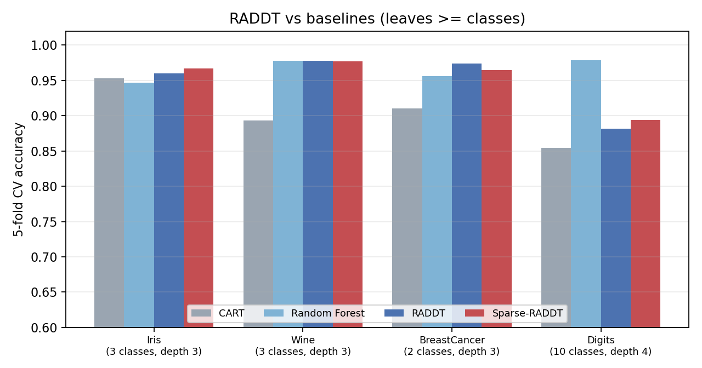
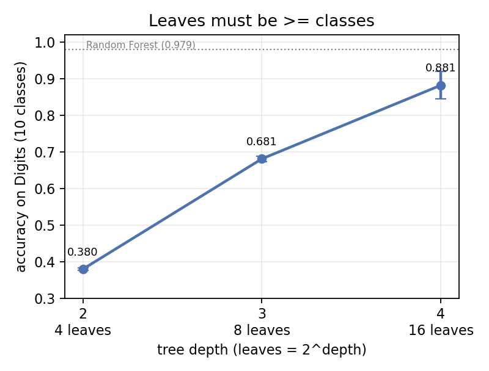
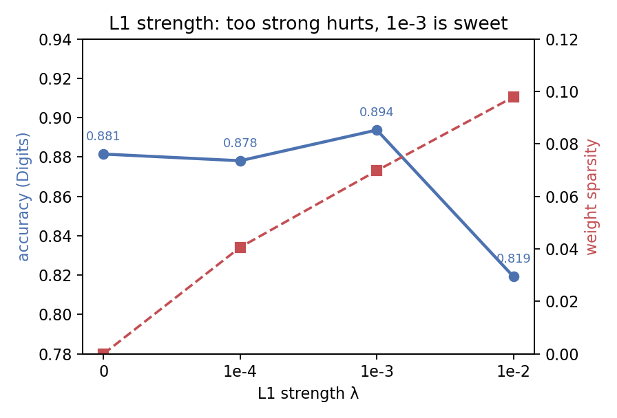

# Sparse-RADDT

> 复现 **RADDT**（ReLU + Argmin 重构的可微分决策树，NeurIPS 2025），并在分裂权重上加 **L1 稀疏正则**做特征选择。
> 4 个 UCI 数据集 × 5 折交叉验证，对比 CART / Random Forest。
>
> 过程中在自己第一版实现里找出并修掉了四个错误：**sklearn clone 丢参数**、**叶子数少于类别数**、**正则强度用错**、**分类器没被 sklearn 认出来**。
> 修完之后，RADDT 在 4 个数据集上全部超过 CART；调好强度的稀疏版在 Iris 和 Digits 上继续提升。

**English summary.** A reproduction of RADDT (NeurIPS 2025), a differentiable decision-tree formulation, plus an L1-sparse variant. Four UCI datasets, 5-fold cross-validation, controlled ablations on tree depth and regularization strength, and a documented account of three implementation bugs found in our own first version (sklearn parameter cloning, leaf count vs. class count, inconsistent regularization). Technical report under `paper/`; self-checks in `test_raddt.py`.

---

## 1. RADDT 是什么

传统决策树用贪心策略逐层分裂，只保证局部最优。RADDT 把整棵树重构成**无约束可微优化**：

- 每个内部节点有分裂权重 `a_j` 和阈值 `b_j`；
- 样本沿路径走，每次"该左转却右转"产生一个 ReLU 违反量；
- **正确路径的累积违反量恒为 0**，所以"落到哪个叶子"= `argmin` 累积违反量；
- 训练时用 scaling softmin 近似 argmin，α 从 2 退火到 200，逐步逼近硬路由。

好处：保留硬分裂的可解释性，同时能端到端梯度优化。

## 2. Sparse-RADDT

RADDT 的分裂权重在高维数据上是稠密的——每个节点都用全部特征。改动只有一行：

```python
loss = base_loss + l1_lambda * A.abs().sum()
```

## 3. 结果



5 折交叉验证，树深按 `leaves ≥ classes` 设置，λ=1e-3：

| 数据集 | 类别 | 树深 | CART | Random Forest | RADDT | Sparse-RADDT | 稀疏度 |
|---|---|---|---|---|---|---|---|
| Iris | 3 | 3 | 0.953 | 0.947 | 0.960 | **0.967** | 21.4% |
| Wine | 3 | 3 | 0.893 | 0.978 | 0.978 | 0.977 | 15.4% |
| BreastCancer | 2 | 3 | 0.910 | 0.956 | **0.974** | 0.965 | 11.9% |
| Digits | 10 | 4 | 0.855 | 0.978 | 0.882 | **0.894** | 7.0% |

- **RADDT 在 4 个数据集上全部超过 CART**；
- 在 Wine 和 BreastCancer 上追平甚至略超随机森林；
- Digits 上仍明显弱于随机森林——单棵树的方差压不下去，这是结构问题，不是训练问题。

## 4. 两个受控实验

### 4.1 叶子数必须 ≥ 类别数

固定 λ=0、固定种子，只改树深，在 Digits（10 类）上：



| 树深 | 叶子数 | 准确率 |
|---|---|---|
| 2 | 4 | 0.380 |
| 3 | 8 | 0.681 |
| 4 | 16 | **0.882** |

8 个叶子去装 10 个类别，准确率被结构性地压在 0.68。

### 4.2 L1 强度必须调

在 Digits 上扫三个量级：



| λ | 准确率 | 权重稀疏度 |
|---|---|---|
| 0（无正则） | 0.882 | 0% |
| 1e-4 | 0.878 | 4.1% |
| **1e-3** | **0.894** | 7.0% |
| 1e-2 | 0.819 | 9.8% |

**正则不是越强越好**：λ=1e-3 在更稀疏的同时还涨了 1.2 个百分点；λ=1e-2 直接把准确率打掉 6 个点。

## 5. 我在自己第一版里修掉的四个错误

这一节比结果表更值得看。

1. **sklearn `clone` 静默丢参数。**
   第一版的分类器用 `**kwargs` 收参数，而 `clone()` 只按 `__init__` 的显式签名重建对象。于是交叉验证时 `n_alpha_stages=4, n_restarts=2` 被丢回默认值，论文里写的实验设置根本没生效。
   → 改成全部显式参数，并在脚本里断言 `get_params()` 拿得到；`test_raddt.py` 里加了回归测试。

2. **叶子数少于类别数。**
   第一版对所有数据集都用 `depth=3`（8 个叶子），但 Digits 是 10 类。模型结构上就装不下。
   → 改成 `depth = max(3, ceil(log2(n_classes)))`，并补了上面的受控对照。

3. **正则强度前后不一致。**
   第一版复跑时改了 λ 却没记录，导致"深度修正带来提升"这个结论混入了第二个变量。
   → 现在所有对照都固定其它因素，只动一个变量。

4. **估计器没被 sklearn 认成分类器。**
   继承写成 `class RADDTClassifier(RADDTBase, ClassifierMixin)`，mixin 排在后面，`is_classifier()` 返回 `False`。
   于是 `cross_val_score(..., cv=3)` 退回普通 KFold；Iris 按类别排序，每折整折同一类，训练集里根本没有这个类，准确率直接是 **0**。
   显式传 `StratifiedKFold` 时一切正常，所以只有换一种调用方式才会暴露。
   → mixin 放到前面，并加了一条用整数 `cv` 的回归测试。

## 6. 局限

- 只有 4 个 sklearn 内置数据集（150–1797 样本），结论不能外推到真实规模；
- 没有做超参搜索，λ 是手工扫出来的；
- 单一种子，没跑多次重复实验；
- RADDT 训练比 CART 慢 2–3 个数量级（每折 1–30 秒 vs 0.02 秒）；
- 没有和 OCT / ORT 这类精确全局优化方法对比。

## 7. 测试与已知边界

`test_raddt.py` 覆盖五件事：参数克隆、sklearn 协议识别、Iris 拟合、回归输出连续值、同种子可复现。

其中「协议识别」是一条历史 bug 的回归测试：分类器的 mixin 顺序写反时，`is_classifier()` 会返回 `False`，`cross_val_score(..., cv=3)` 就会退化成普通 KFold；Iris 按类别排序，每折整折同类，准确率直接变成 0。现在已修正，并用整数 `cv` 的用例锁住。

已知边界：

- 单一种子、只做 5 折，未做嵌套交叉验证；
- **λ=1e-3 是在同一组折上选出来的**，所以主表里 +1.2 个百分点属于探索性结果，不是无偏估计；严格做法是嵌套 CV 或独立验证集，本文没做；
- 只有 4 个内置数据集，规模 150–1797。

## 8. 运行

```bash
pip install -r requirements.txt

python test_raddt.py          # 5 个自检，约 20 秒
python run_experiment.py      # 主表，约 4 分钟
python depth_study.py         # 树深对照，约 2 分钟
python lambda_sweep.py        # 正则强度扫描，约 2 分钟
python adaptive_lambda.py     # 固定强度 vs 自适应，约 4 分钟
python visualizations.py      # 特征重要性 / 决策边界 / 收敛曲线，约 1 分钟
python plot_results.py        # 出图
```

## 9. 文件

```
raddt.py             模型实现（分类 / 回归，显式参数，可复现）
run_experiment.py    主实验：CART / RF / RADDT / Sparse-RADDT
depth_study.py       树深对照
lambda_sweep.py      L1 强度扫描
adaptive_lambda.py   固定强度 vs 自适应强度
visualizations.py    特征重要性 / 决策边界 / 收敛曲线
plot_results.py      三张图
test_raddt.py        自检（参数克隆 / 拟合 / 回归 / 确定性）
paper/               技术报告（docx）与生成脚本
results/             实验输出 CSV
figures/             图
```

技术报告：[`paper/Sparse-RADDT-report.docx`](paper/)（含全部实验、三张图与第 6 节的复现陷阱）。
